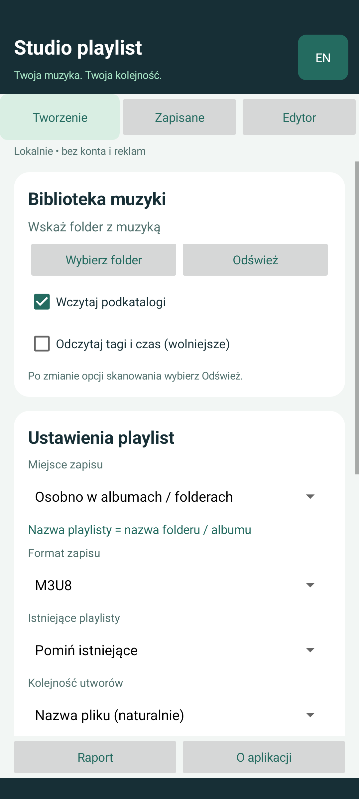

# Studio playlist — Android

Native Android playlist creator and editor, based on the [Listy Windows project](https://github.com/zetmar-collab/Listy). **English / Polski** · [Polska instrukcja](README.md)

[**Download APK — Android 8.0+**](https://github.com/zetmar-collab/Listy-Android/releases/latest/download/Listy-Android-1.0.0.apk) · [Releases](https://github.com/zetmar-collab/Listy-Android/releases) · [MIT license](LICENSE)

The APK is development-signed for installation and testing. Download it to your phone and open it with Android's package installer. The release includes a SHA-256 checksum. This repository contains the standalone Android source project.



## Features

- Select a music folder using Android's system document picker; optionally scan subfolders.
- Generate a playlist in each album folder using the folder name, or one combined list in the root or a named subfolder.
- Select audio extensions: MP3, FLAC, WAV, M4A, AAC, OGG, OPUS, WMA, AIFF, AIF, APE and ALAC.
- Read and write M3U8, M3U, PLS, XSPF and WPL. Write UTF-8; read UTF-8, UTF-16 BOM and legacy Windows-1250.
- Preview the generation plan. Skip existing lists, update with a `.bak` backup or create a numbered version.
- Manually add, remove and reorder entries, preview playlists, rename lists, and undo/redo up to 30 in-memory changes.
- Check duplicate/missing entries and repair paths after moving music. Saved playlist deletion is confirmed and permanent; music files are not deleted.
- Optional read-only audio metadata via Android's MediaMetadataRetriever. Availability depends on the device's supported formats.
- Polish/English UI, local settings and draft, background file operations and cancellation between steps.

No account, advertising, analytics, Internet, camera, microphone or broad-storage permission is requested by the app. Access is granted through files/folders you explicitly choose. Cloud document providers may use their own network connection.

## File compatibility and backups

For the best player compatibility, choose your music folder and save playlists **inside the library with relative paths**. Files selected outside the library or through some document providers may use `content://` locations. Other players do not automatically receive those grants and may not support those references.

System **Export as** creates a new file with absolute/content references because the destination is selected after its contents are prepared. **Save in library** can correctly compute relative paths.

Import preserves tracks, titles, durations and supported XSPF artist/album fields. Saving rebuilds the file and can omit comments and custom metadata; updating within the library creates an original `.bak` first. SAF providers do not guarantee atomic replacement: the app attempts to restore the original if writing fails. Backups can be recovered manually. Cancellation does not undo completed writes.

Android 11+ restricts selecting storage roots and the top-level Download folder. Choose Music or a subfolder instead. Read-only providers can reject write/rename/delete operations.

Limits: 32 MB per imported playlist, 200,000 scanned entries, 10,000 folders, depth below 100. Views show up to 300 albums, 200 saved lists or 250 editor tracks at once; search narrows the view. Search does not deselect hidden albums.

## Build and tests

Requires JDK 17 and Android SDK platform 36. The repository pins Gradle 8.13 (checksum-verified wrapper) and AGP 8.13.2. From the repository root:

```sh
./gradlew testDebugUnitTest lintDebug assembleDebug
# With a test device/emulator connected:
./gradlew connectedDebugAndroidTest
```

On Windows:

```powershell
.\scripts\Build.ps1
# Include instrumented device tests:
.\scripts\Build.ps1 -ConnectedTests
```

The script copies the development-signed APK and checksum to `dist/1.0.0/`. Android APK signing is separate from Windows MSIX signing. The Android SDK debug key is used for this test build; it is not included in Git. A production distribution requires a dedicated release-signing process.

Validation: 21 JVM tests and 8 instrumented tests on an API 37 emulator passed. Instrumented tests use an isolated fake document provider with real disposable files, plus activity tests for language switching and tabs. They do not cover every physical phone, SD card or cloud provider. Android Lint completed with no errors; version/dependency recommendations remain.

GitHub Actions builds the standalone project and runs JVM tests and lint. The published APK is the locally verified binary; GitHub-hosted builds use a separate temporary debug key.

## Structure

`MainActivity` implements the bilingual native UI and editor history. `Storage` handles SAF/document operations. `PlaylistCodec` and `Track` provide the platform-independent playlist logic. Test-only code and permissions are excluded from the installation APK.

Support: [GitHub Issues](https://github.com/zetmar-collab/Listy-Android/issues). License: [MIT](LICENSE).
