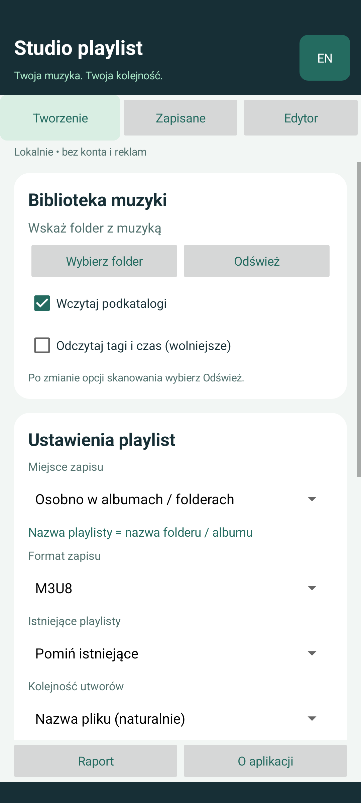

# Studio playlist — Android

**Polski / English** · [English guide](README.en.md) · [Wersja Windows](https://github.com/zetmar-collab/Listy)

[**Pobierz APK — Android 8.0+**](https://github.com/zetmar-collab/Listy-Android/releases/latest/download/Listy-Android-1.0.0.apk) · [Wydania](https://github.com/zetmar-collab/Listy-Android/releases)

APK jest podpisany dewelopersko i przeznaczony do instalacji testowej. Suma SHA-256 jest dołączona do wydania. Pobierz APK na telefon i otwórz go, aby rozpocząć instalację przez system Android.



Natywna aplikacja Android oparta na funkcjach desktopowego projektu Listy. Wymaga Androida 8.0 (API 26) lub nowszego. Działa offline, bez konta, reklam, analityki, uprawnień do aparatu i szerokiego dostępu do pamięci. Obsługuje polski i angielski interfejs.

## Funkcje

- Wybór katalogu przez systemowy Storage Access Framework, trwałe uprawnienie do wskazanego folderu, opcjonalne skanowanie podkatalogów.
- Album to folder zawierający pliki muzyczne. Osobna playlista w każdym albumie otrzymuje jego nazwę. Dostępny jest też zapis jednej listy w katalogu głównym lub nazwanym podkatalogu.
- Wybór rozszerzeń: MP3, FLAC, WAV, M4A, AAC, OGG, OPUS, WMA, AIFF, AIF, APE, ALAC. To filtr plików; odczyt tagów zależy od kodeków Androida.
- Zapis i odczyt M3U8, M3U, PLS, XSPF i WPL. Zapis UTF-8, odczyt UTF-8/UTF-16 z BOM i Windows-1250. Maksymalny odczyt playlisty: 32 MB.
- Podgląd planu, zaznaczanie albumów, wyszukiwanie, naturalne sortowanie nazw lub sortowanie po wykonawcy i tytule.
- Istniejące listy: pomijanie, aktualizacja z kopią `.bak`, nowa numerowana wersja.
- Ręczny edytor: dodawanie plików, zmiana kolejności po dotknięciu utworu, usuwanie wpisów, 30 kroków cofania/ponawiania, podgląd, kontrola brakujących plików i duplikatów, naprawa starego prefiksu ścieżek.
- Odczyt tagów i czasu z wykorzystaniem systemowego MediaMetadataRetriever. Nie zapisuje tagów do plików muzycznych.
- Otwieranie, zmiana nazw i usuwanie zapisanych playlist. Usuwanie pliku playlisty wymaga potwierdzenia i jest trwałe; Android SAF nie zapewnia przeniesienia do Kosza.
- Ustawienia i roboczy szkic edytora zapisywane lokalnie. Skanowanie i operacje plikowe działają w tle; anulowanie zatrzymuje dalsze kroki, a zakończone zapisy pozostają na dysku.

## Korzystanie z plików

Najpierw wskaż np. folder **Music** lub jego podfolder. Android 11+ nie pozwala wskazać całego głównego katalogu pamięci ani głównego folderu Download. Nie jest wymagane przyznanie uprawnienia „Wszystkie pliki”. Systemowy dostawca dokumentów może udostępniać foldery tylko do odczytu; aplikacja pokaże wtedy błąd zapisu.

Najlepsza zgodność z innymi odtwarzaczami: wczytaj folder muzyczny, wybierz **ścieżki względne** i zapisuj playlisty w tej bibliotece. W przypadku dokumentów wybranych spoza biblioteki lub dostawcy chmurowego adres może mieć postać `content://`. Uprawnienie do takiego adresu nie jest automatycznie przekazywane innym odtwarzaczom; nie wszystkie je obsługują. Eksport przez systemowe „Zapisz jako” używa odniesień bezwzględnych/content URI, ponieważ docelowy folder jest wybierany dopiero w tym oknie. Zapis do biblioteki pozwala prawidłowo przeliczyć ścieżki względne.

Import zachowuje podstawowe informacje: wpisy, tytuły, czasy oraz obsługiwane pola wykonawcy/albumu XSPF. W przeciwieństwie do wersji Windows, zapis odbudowuje plik i **nie zachowuje wszystkich komentarzy, atrybutów i niestandardowych metadanych**. Aktualizacja w bibliotece tworzy kopię oryginału. SAF nie gwarantuje atomowej podmiany: aplikacja zapisuje kopię przed nadpisaniem, a po błędzie podejmuje próbę odtworzenia oryginału. Kopię `.bak` można odzyskać ręcznie. Nie należy traktować synchronizowanego folderu chmurowego jako atomowego systemu plików.

Naprawa ścieżek: wczytaj nowy katalog muzyczny, otwórz playlistę, wybierz **Napraw ścieżki** i podaj stary katalog. Zastępowane są wyłącznie niedostępne wpisy zaczynające się od całego prefiksu folderu, dla których istnieje odpowiednik w aktualnie wczytanej bibliotece. Zmianę można cofnąć przed zapisem.

Skanowanie ma ograniczenia bezpieczeństwa: 200 000 elementów, 10 000 folderów, maksymalna głębokość 100. W widokach wyświetlanych jest do 300 albumów, 200 playlist i 250 utworów naraz; wyszukiwarka pozwala zawęzić widok. Ukrycie zaznaczonego albumu przez filtr nie wyłącza go z generowania.

## Budowanie

Wymagane JDK 17, Android SDK z platformą 36 i dostęp do repozytoriów Google/Maven przy pierwszym uruchomieniu. Gradle Wrapper 8.13 i Android Gradle Plugin 8.13.2 są przypięte w projekcie.

```powershell
.\gradlew.bat testDebugUnitTest lintDebug assembleDebug
# Z uruchomionym emulatorem lub telefonem testowym:
.\gradlew.bat connectedDebugAndroidTest
```

Alternatywnie z katalogu głównego repozytorium:

```powershell
.\scripts\Build.ps1
```

Skrypt kopiuje podpisany dewelopersko APK do `dist/1.0.0/` i zapisuje SHA-256. Jest to pakiet do instalacji/testów, podpisany standardowym kluczem debug Android SDK; podpis nie jest certyfikatem używanym do MSIX. Publikacja w Google Play wymaga osobnego klucza wydania oraz AAB. Kluczy prywatnych nie należy dodawać do Git.

## Architektura

```text
MainActivity (PL/EN, ustawienia, edytor, historia)
    → Storage (DocumentsContract, uprawnienia SAF, skanowanie, kopie)
    → PlaylistCodec + Track (niezależna logika formatów i ścieżek)
```

Kod Windows pozostaje osobnym projektem. Java wykorzystuje natywne kontrolki i API Androida; aplikacja nie pakuje WPF ani środowiska .NET.

Testy JVM sprawdzają formaty, kodowania, XML, ścieżki i walidację nazw. Testy na Androidzie korzystają z izolowanego dostawcy dokumentów z rzeczywistymi plikami testowymi, sprawdzając odczyt, zapis, kopie, wersjonowanie, zmianę nazwy i usuwanie. Dostawca testowy istnieje wyłącznie w testowym APK i nie trafia do aplikacji. Osobne testy uruchamiają ekran aplikacji oraz sprawdzają zakładki i zmianę języka. Nie obejmuje to wszystkich modeli telefonów, kart SD ani dostawców chmurowych.

Licencja MIT — jak w projekcie głównym. Zależności JUnit, AndroidX Test i Google Truth są używane tylko przy testowaniu.
